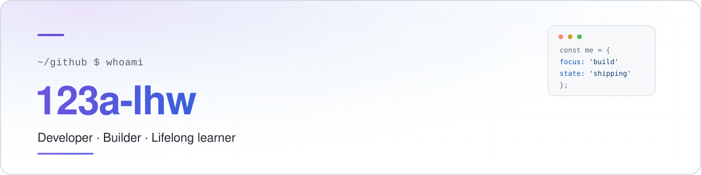

<!--
  ════════════════════════════════════════════════════════════════════
   PROFILE README  ·  123a-lhw/123a-lhw
  ────────────────────────────────────────────────────────────────────
   Where to edit:
   · 名字 / 简介  →  assets/hero-dark.svg 与 assets/hero-light.svg
   · 自我描述     →  「about」区块
   · 技术栈       →  「stack」区块（删掉不用的 badge 即可）
   · 社交链接     →  「connect」区块
  ════════════════════════════════════════════════════════════════════
-->

<div align="center">

<picture>
  <source media="(prefers-color-scheme: dark)" srcset="./assets/hero-dark.svg">
  <source media="(prefers-color-scheme: light)" srcset="./assets/hero-light.svg">
  
</picture>

<br/><br/>

<a href="https://github.com/123a-lhw">
  
</a>


</div>

<br/>

## `$` about

```yaml
name:     123a-lhw
role:     software developer
focus:    building useful things, one commit at a time
status:   learning in public
```

I care about code that is easy to read, interfaces that feel fast, and
shipping instead of polishing forever. This profile is where the work
in progress lives — rough edges included.

- 🔭 **Building** — side projects, mostly around web tooling and developer experience
- 🌱 **Learning** — TypeScript, Go, distributed systems
- 🤝 **Open to** — collaboration, code review, and interesting open-source problems
- 💬 **Ask me about** — anything you see in the repos below

<br/>

## `$` stack

<div align="center">

**Languages**


**Frontend**


**Backend &amp; Data**


**Tooling**


</div>

<br/>

## `$` github

<div align="center">


<br/>


<br/>


</div>

<br/>

## `$` connect

<div align="center">

<a href="https://github.com/123a-lhw">
  
</a>
<a href="https://github.com/123a-lhw?tab=repositories">
  
</a>
<a href="https://github.com/123a-lhw/123a-lhw/issues">
  
</a>

</div>

<br/>

---

<div align="center">
  <sub>
    <i>The best way to predict the future is to build it.</i>
    <br/>
    <sub>Readme · hand-built, no template</sub>
  </sub>
</div>
